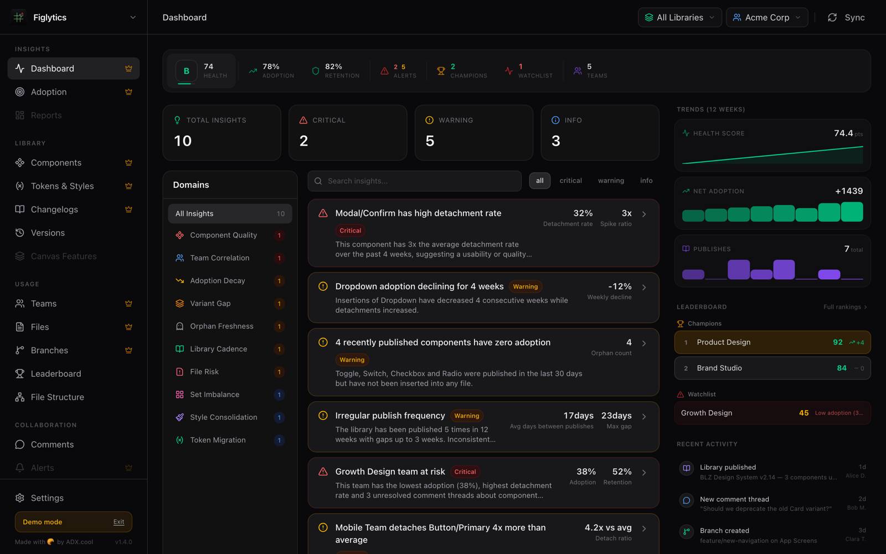
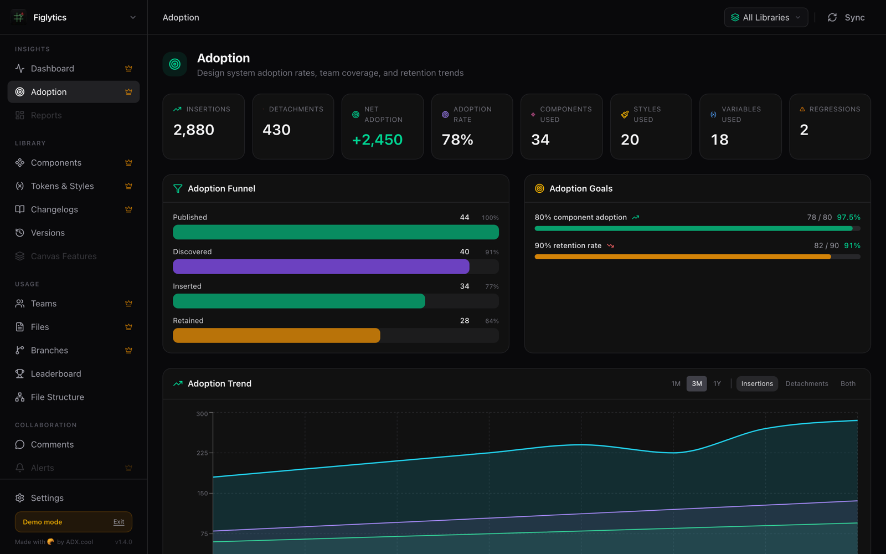
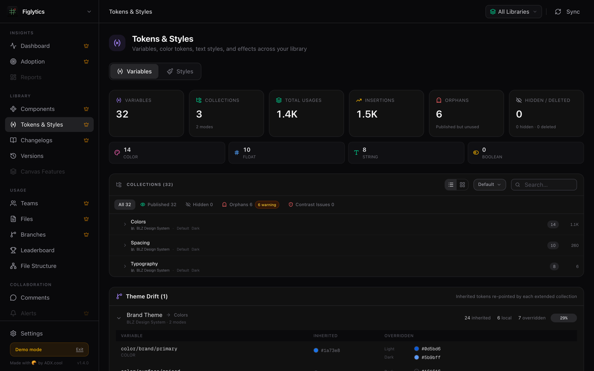
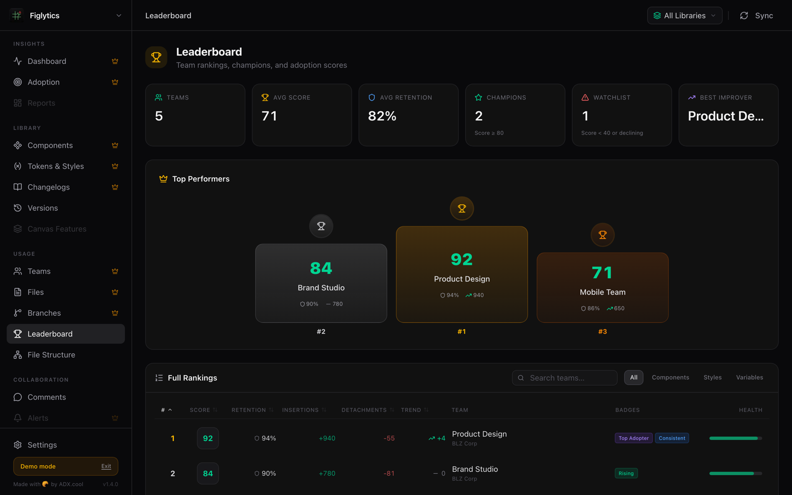
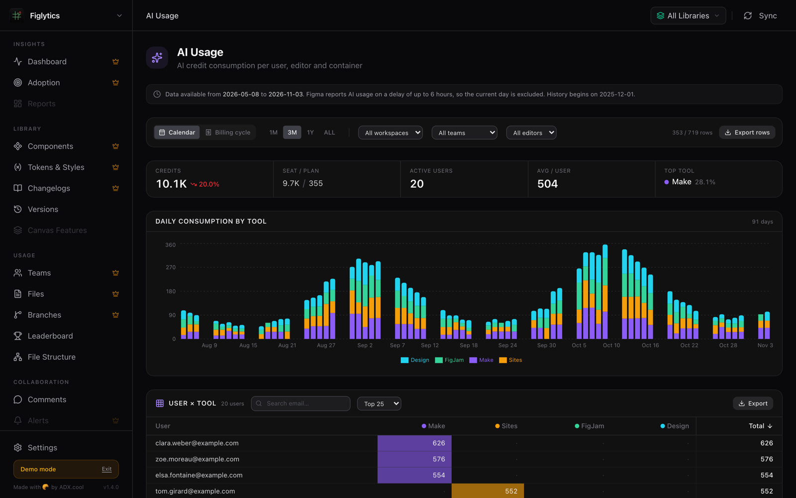
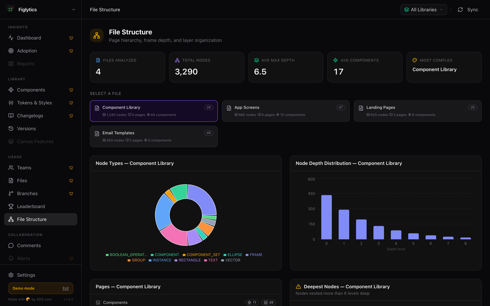
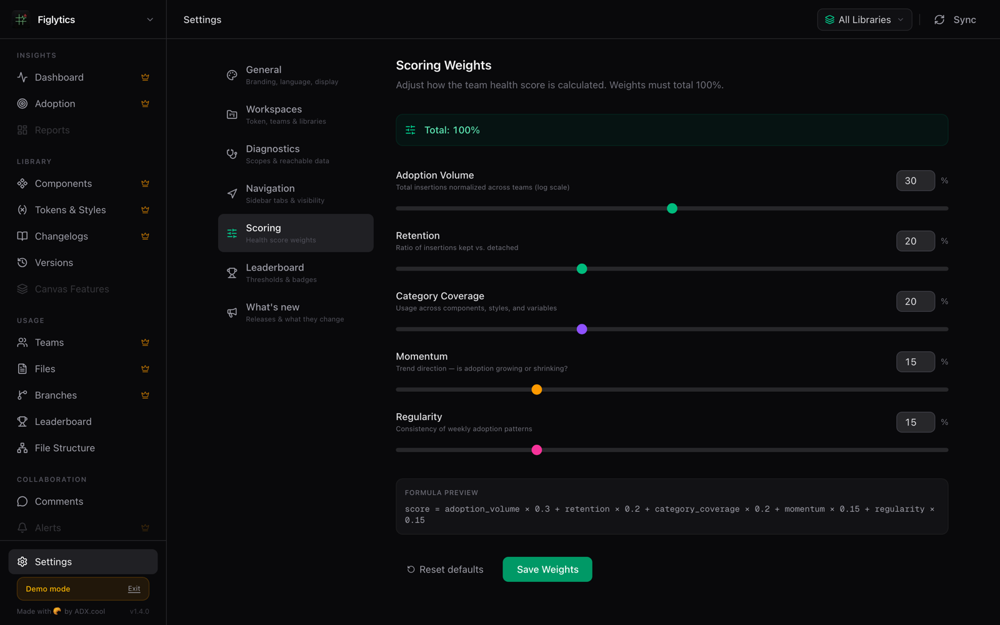

<div align="center">


# Figlytics

**Analytics for Figma design systems.** Component adoption, tokens and styles, team health, insights and Figma AI spend in one dashboard. Use it in the cloud or run it on your own infrastructure.

[](https://github.com/aedhx/figlytics-selfhosted/releases/latest)
[](https://github.com/users/aedhx/packages/container/package/figlytics)
[](#quick-start)
[](LICENSE)
[](#privacy)

[Website](https://figlytics.adx.cool) · [Cloud app](https://app.figlytics.adx.cool) · [Changelog](https://figlytics.adx.cool/changelog) · [Releases](https://github.com/aedhx/figlytics-selfhosted/releases) · [Report a bug](https://github.com/aedhx/figlytics-selfhosted/issues/new/choose) · [Security](https://github.com/aedhx/figlytics-selfhosted/security)

</div>

<br />



<p align="center"><sub>All screenshots come from the app's demo mode. The organizations, teams and people in them are fictional.</sub></p>

## Why Figlytics

Design-system teams ship libraries to dozens of product teams and then lose sight of what happens next. Which components are actually used? Which ones get detached? Which tokens are dead weight? Which team is drifting away from the system?

Figma's built-in Library Analytics gives you numbers, one library at a time. Figlytics turns them into answers: every library and every team in one view, a health score you can tune, and insights that point at the component, team or file that needs attention.

Everything comes from the official Figma REST API. Figlytics reads analytics data; the only thing it ever writes is a comment you post or delete yourself from the Comments page.

### What you get

- **Health score**: a single 0–100 grade (A–F) per team and workspace, with configurable weights for adoption, retention, coverage, momentum and regularity.
- **Cross-domain insights**: 10 detection engines correlate components, teams, files and styles to surface detachment spikes, adoption decay, orphaned components, irregular publishing and more.
- **Adoption**: insertions vs. detachments per component, an adoption funnel, goals and trends over time.
- **Search and filter**: find any component, variable or style on its page, with type filters and usage counts.
- **Leaderboard and multi-team hub**: rank teams by health score, spot champions and the watchlist, compare teams across workspaces.
- **Token, style and contrast audit**: orphan detection, usage tracking, theme drift and WCAG contrast checks across variables and text styles.
- **AI usage and FinOps**: Figma AI credits per user, editor and container, tracked against the billing cycle, with burn rate and cost projection.
- **Governance**: token activity and sign-ins, plugin approvals, webhook delivery health and Figma Sites publishing.
- **Comments kanban**: every unresolved thread across your files, with age and status at a glance.
- **Canvas and file structure**: which recent Figma capabilities your libraries use, plus page hierarchy and frame depth per file.
- **Access diagnostics**: see exactly which Figma permissions your token has and what each missing one costs, page by page.
- **Product changelog**: Settings → What's new lists every release and what it changes.

## A closer look

<table>
  <tr>
    <td width="50%" valign="top">
      <h3>Adoption</h3>
      <p>Follow components from published to retained, and catch regressions before they spread.</p>
      
    </td>
    <td width="50%" valign="top">
      <h3>Tokens and styles</h3>
      <p>Variables by collection and type, orphans, contrast issues and theme drift between collections.</p>
      
    </td>
  </tr>
  <tr>
    <td width="50%" valign="top">
      <h3>Leaderboard</h3>
      <p>Rank teams by health score, with retention, insertions, detachments and badges.</p>
      
    </td>
    <td width="50%" valign="top">
      <h3>AI usage</h3>
      <p>Daily Figma AI credit consumption by tool, and a user × tool matrix you can export.</p>
      
    </td>
  </tr>
  <tr>
    <td width="50%" valign="top">
      <h3>File structure</h3>
      <p>Node types, depth distribution and the most deeply nested frames, file by file.</p>
      
    </td>
    <td width="50%" valign="top">
      <h3>Your health score, your rules</h3>
      <p>Tune the weights behind the score to match what your team cares about.</p>
      
    </td>
  </tr>
</table>

## Cloud or self-hosted

Both are free and run the same app.

| | Cloud | Self-hosted |
|---|---|---|
| Setup | None: open [app.figlytics.adx.cool](https://app.figlytics.adx.cool) | `docker compose up -d` |
| Runs on | Figlytics' servers | Your infrastructure |
| Figma token | Stays in your browser and goes straight to the Figma API | Stored in the data volume on your server |
| Your Figma data | Processed on the fly, nothing stored | Cache and saved reports stay on your server |
| Access | Each person connects with their own Figma token | One shared instance, protected by an optional password |
| Updates | Automatic | `docker compose pull`, on your schedule |

This repository is for the **self-hosted** version. It holds the documentation, the compose file and the releases of the Docker image. The source code is not public.

## Quick start

Requires Docker.

With Docker Compose:

```bash
curl -O https://raw.githubusercontent.com/aedhx/figlytics-selfhosted/main/docker-compose.yml
docker compose up -d
```

Or with a single `docker run`:

```bash
docker run -d --name figlytics -p 127.0.0.1:3000:3000 -v figlytics-data:/data --restart unless-stopped ghcr.io/aedhx/figlytics:1
```

Open [http://localhost:3000](http://localhost:3000) and follow the setup wizard: paste a Figma personal access token, then pick your libraries and team.

The image is `ghcr.io/aedhx/figlytics`, published for `linux/amd64` and `linux/arm64`. Each release is tagged with its exact version (`1.4.1`), its minor (`1.4`) and major (`1`) lines, and `latest`.

## Figma requirements

Most pages rely on the Figma Library Analytics API (`library_analytics:read`), available on the **Figma Enterprise** plan. Leaderboard, Comments and Settings work on lower plans. Settings → Diagnostics tells you exactly which permissions your token has and what each missing one costs. Details: [figlytics.adx.cool](https://figlytics.adx.cool/#faq).

## Configuration

| Variable | Default | Purpose |
|---|---|---|
| `FIGLYTICS_PASSWORD` | unset | Instance password. Unset: no login. Set: every page and API requires signing in. |
| `FIGLYTICS_ALLOWED_HOSTS` | unset | Without a password, Figlytics only answers when opened as `localhost`, `127.0.0.1` or `[::1]`. List other host names here, comma-separated, each with an optional port (`figlytics.lan,nas.local:8080`). Not needed once a password is set. |
| `FIGLYTICS_DATA_DIR` | `/data` | Where configuration, cache and saved reports are stored. Keep it on a volume. |
| `PORT` | `3000` | Port the server listens on inside the container. Changing it also means changing the container side of the port mapping (`PORT=8080` → `127.0.0.1:3000:8080`). The healthcheck follows `PORT` from 1.4.1. |

Figlytics refuses changes sent from other websites (cross-site requests), with or without a password.

### Using a host directory instead of the volume

The container runs as user `1000`. If you mount a directory from the host (`./data:/data`) instead of the named volume, give it to that user first:

```bash
mkdir -p data && sudo chown 1000:1000 ./data
```

## Sharing it with your team

Without a password, anyone who can reach the port can read your Figma data. That is why the compose file only publishes it on `127.0.0.1`, and why a password-less instance only answers when opened as `localhost`.

To share the dashboard:

1. set `FIGLYTICS_PASSWORD` to a long password;
2. put it behind a reverse proxy with **HTTPS** (Caddy, Traefik, nginx…) that forwards the original `Host` header and `X-Forwarded-Proto` (Caddy and Traefik do by default; nginx needs `proxy_set_header Host $host;` and `proxy_set_header X-Forwarded-Proto $scheme;`). The session cookie is marked `Secure` when the proxy says the connection is HTTPS;
3. if the proxy runs **on the same host**, keep the `127.0.0.1:3000:3000` binding and point the proxy at `http://127.0.0.1:3000`. Only publish `"3000:3000"` when the proxy runs on another machine, and then restrict who can reach the port: Docker publishes ports past host firewalls such as `ufw`.

Sessions last 30 days. Changing the password signs everyone out.

To open a password-less instance under another name on a network you trust, list that name in `FIGLYTICS_ALLOWED_HOSTS`. Everyone who can reach it can read your Figma data, so a password is the better choice.

## Updating

```bash
docker compose pull
docker compose up -d
```

With `docker run`, pull the new image, then remove and recreate the container with the same command; the `figlytics-data` volume keeps your data.

`ghcr.io/aedhx/figlytics:1` follows the latest 1.x release. Pin an exact version (`:1.4.1`) if you prefer to update deliberately. Release notes are on the [Releases](https://github.com/aedhx/figlytics-selfhosted/releases) page, and the running version is shown in Settings → General, in the About block.

## Backups

Everything Figlytics writes lives in the `figlytics-data` volume. Back up that volume; nothing else is needed.

## Privacy

The image talks to the Figma API and nothing else. It contains no telemetry and no analytics.

## Troubleshooting

- **The page asks for a password I never set**: another `FIGLYTICS_PASSWORD` is set in your environment or compose file.
- **I can't sign in behind my proxy**: you are most likely opening the site over plain `http://` while the proxy tells Figlytics the connection is HTTPS, so the session cookie is `Secure` and the browser drops it. Open the site with `https://`. Also check that the proxy forwards `X-Forwarded-Proto`, so the cookie's `Secure` flag matches how you really reach the site.
- **"Host not allowed"**: the instance has no password and you opened it under a name other than `localhost`. Set `FIGLYTICS_PASSWORD` (recommended as soon as others can reach it), or list that host in `FIGLYTICS_ALLOWED_HOSTS`. Behind a reverse proxy, also check that it forwards the original `Host` header.
- **A page says a credential is missing**: open Settings → Diagnostics.

## Support

Bugs and feature requests: [open an issue](https://github.com/aedhx/figlytics-selfhosted/issues/new/choose) and include the version from Settings → General. Security issues: use **Report a vulnerability** in the [Security tab](https://github.com/aedhx/figlytics-selfhosted/security), not a public issue.

## License

Free to use, including commercially, for the internal needs of your organization. No redistribution, resale or hosting for third parties. See [LICENSE](LICENSE).

---

<div align="center">
<sub>
Figlytics is not affiliated with, endorsed by or sponsored by Figma, Inc. Figma is a trademark of Figma, Inc.<br />
Made by <a href="https://github.com/aedhx">@aedhx</a> · <a href="https://adx.cool">adx.cool</a>
</sub>
</div>
